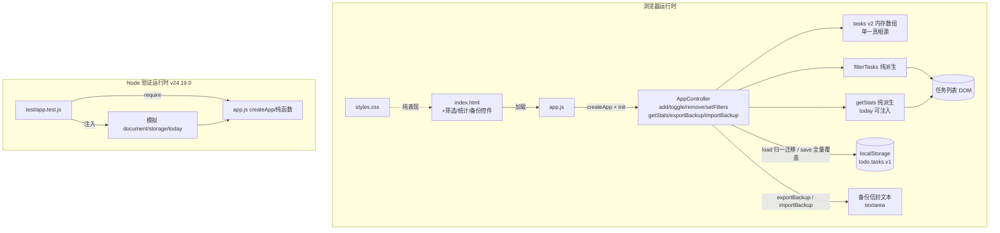

# Design Candidate — 极简待办清单·功能补齐（CORE 模块设计演进）

| 元数据 | 值 |
|---|---|
| work_item_id | WI-0002 |
| module_id | CORE |
| base_spec_version | PSV-0002 |
| 产物性质 | **演进**（基于 PSV-0002 modules/CORE/design.md DD-CORE-001 至 DD-CORE-008；本候选为完整目标文件：DD-CORE-001 至 DD-CORE-008 以演进版呈现——受影响条款加「演进说明」，未受影响条款原文保持；新增 DD-CORE-009 至 DD-CORE-017） |
| 上层输入 | Architecture 保持（ARCH-CORE-001 至 ARCH-CORE-005，无架构候选）；本 WI data_model.candidate.md（DATA-CORE-001 至 DATA-CORE-009）；contracts.candidate.json（MCONTRACT-CORE-001 至 MCONTRACT-CORE-005 保持 + 006 演进 + 007 新增） |
| 需求输入 | requirements.candidate.md（REQ-CORE-001 至 REQ-CORE-017 / AC-001 至 AC-061，已冻结，只读） |
| 环境约束 | prod-environment.md（静态前端、键 todo.tasks.v1、Node v24.19.0、无浏览器自动化工具）；host-profile.json（win32、Node 24.19.0）；project-rules.md 为 TODO 占位 |

> 基线声明：implementation_baseline 记录 current_file_count=4、all_planned_paths_missing=false，index.html / app.js / styles.css / test/app.test.js 均为既有正式实现。本设计为演进差量：以已知当前实现为差量基础，不存在「当前实现未知」，无需 design_blocked。

## 1. Problem Understanding

- **症状**：用户需要任务属性（分类/优先级/截止日期）、搜索与组合筛选、四项统计、新字段持久化与旧数据迁移、备份导出/导入。
- **直接问题**：REQ-CORE-007 至 REQ-CORE-017 无设计承接；既有 DD-CORE-001/003/004/005/007/008 的输入校验、渲染、持久化与测试面需扩展。
- **根因假设**：非缺陷，是能力补齐型需求演进（FACT-16：既有功能保留并回归）。
- **待证事实**：层级 B 真实浏览器/剪贴板行为全部 NOT_RUN 待补测；模拟 shim 等价性为层级 A 证据边界假设。

## 2. Existing Architecture Analysis

- **真实组件（一手复核）**：index.html（form#task-form > input#task-input + ul#task-list，script 尾部加载）；app.js（STORAGE_KEY 常量、generateId、isValidTask、loadTasks/saveTasks、renderTasks/buildTaskElement（textContent 语义插入）、createApp({document,storage}) 工厂返回 {addTask,toggleTask,removeTask,init}、UMD 双模式）；test/app.test.js（node:test + 最小 DOM/localStorage shim）；styles.css。
- **调用链**：HTML→app.js→createApp→(loadTasks|saveTasks)→storage 适配器；createApp→renderTasks→DOM；事件：form submit→addTask，list click 委托→toggle/remove。
- **状态权威**：tasks 内存数组单一真相源（DD-CORE-002 不变）；写入边界：四文件 code_paths，protected-marker.txt 与 .specforge/** 永久排除。
- **当前实现已知**，无 design_blocked。

## 3. Governance Classification

- 模块层设计演进 + Module Contract 演进（MCONTRACT-CORE-006 交互面扩展、新增 MCONTRACT-CORE-007 行为面；MCONTRACT-CORE-001 至 MCONTRACT-CORE-005 保持 PSV-0002 原文不变），均走 owner 模块候选 → Gate → 用户审批 → Merge。
- 消费关系（Contract → DD，唯一真相源为正文 constrained_by + trace_delta 由 sf-task-planner 生成）：新增 DD-CORE-009 至 DD-CORE-017 消费 MCONTRACT-CORE-006（演进版）/MCONTRACT-CORE-007；DD-CORE-010/014 消费 MCONTRACT-CORE-003（损坏降级语义扩展自 DATA-CORE-005 演进）；既有消费关系（DD-001←002c、DD-002/004←001c、DD-007←003c、DD-006←004/005c、DD-003/005←006c）保持。
- 不新增模块/治理层；不修改 Project Contract。

## 4. Existing Capability Assessment

逐层（裁决对象=SpecForge 治理链）：Standard（feature_spec/requirement_change_path 演进场景现有）✅；Contract（candidate_design / candidate_module_contract canonical 类型与 schema 现有）✅；Workflow Skill（候选阶段协议现有）✅；Agent（sf-design 演进契约现有）✅；Tool（sf_artifact_write/sf_doc_lint/sf_handoff 现有）✅；Runtime（manifest 物化现有）✅；Audit（Gate/changed_files_audit 现有）✅。**capability_verdict: reuse_existing**。目标项目的过滤/统计/备份实现属 Solution Strategy，不改变 verdict。

## 5. Solution Strategy

- **最小方案**：在既有四条主结构（内存真相源 / 全量重渲染+事件委托 / 变更后全量覆盖写 / 依赖注入工厂）上扩展——三新字段进入 addTask 与 Task 归一化；筛选与统计为**纯派生函数**（filterTasks / getStats，不落存储）；备份为信封序列化+整体替换导入；渲染扩展新增筛选/统计/备份控件与条目字段呈现。
- **不改什么**：不拆多文件、不引入状态库/框架/构建、不引入第二存储键、不为测试增加业务行为面（today 注入为 createApp 可选项，见 DD-CORE-012 的边界论证）。

## 6. Impact Analysis

- 合并后更新 `.specforge/project/modules/CORE/design.md`（DD-CORE-001 至 DD-CORE-017）；同批生效：data_model.md（DATA-CORE-001 至 DATA-CORE-009）、contracts.json（006 演进/007 新增）。Architecture、module.json code_paths 不变。
- 消费方：sf-task-planner（拆 tasks）与 sf-executor（写入范围仍恰为四文件）；EVREQ-007 至 EVREQ-017 的 A 层级断言基于本设计纯函数边界。
- 契约影响：仅 owner 模块内部契约（006/007），无跨模块消费者，无迁移面。
- 兼容/回归：B1–B5（AC-001 至 AC-023）全量回归；旧数据迁移场景（AC-052 至 AC-054）为新增回归面。
- 边界影响：protected-marker.txt 与 .specforge/** 仍不进入任何消费面（MCONTRACT-CORE-004 保持）。

## 7. Verification Plan

- **静态**：sf_doc_lint(doc_type=design)；canonical Gate（required_files/schema/spec_consistency/trace/workflow_specific）。
- **属性测试**：CP-CORE-001 至 CP-CORE-007（既有，回归）+ CP-CORE-008 至 CP-CORE-012（新增）。
- **集成（层级 A）**：test/app.test.js 于 Node v24.19.0 node:test 逐条覆盖 AC-001 至 AC-061（回归+新增）；逾期以注入 today 取证（等价性注明）。
- **回归**：实现后任何修改重跑全部用例。
- **live acceptance（层级 B）**：真实浏览器/剪贴板全部 NOT_RUN，交后续补测；任何阶段不得声称浏览器/剪贴板已测。

---

## 设计决策

### DD-CORE-001 输入校验流程（演进）

- **refs**: [REQ-CORE-001, REQ-CORE-005]
- basis_refs: [FACT-06, AC-001/005/017/018/019]
- constrained_by: MCONTRACT-CORE-002；DATA-CORE-004/006；prod-environment（纯前端）
- 演进说明：text trim 拒绝逻辑**原文不变**；新增：提交入口同时采集 category/priority/dueDate 原始值，按 DATA-CORE-006 提交列规则归一/校验后随任务入库（DD-CORE-009）。空白 text 拒绝时三新字段原始值同样不产生任何数据效果。
- interface 语义扩展：`addTask(rawText, attrs?): boolean`（attrs 详见 DD-CORE-009）。

### DD-CORE-002 任务状态单一真相源与存储同步（保持）

- **refs**: [REQ-CORE-006, REQ-CORE-001]
- constrained_by: MCONTRACT-CORE-001；ARCH-CORE-003；DATA-CORE-001/002
- 保持原文不变。补充效力声明：筛选/搜索/统计为纯派生，不构成第二真相源；备份导入是唯一整集合替换入口（经 saveTasks 走同一写入路径）。

### DD-CORE-003 渲染策略与事件委托（演进）

- **refs**: [REQ-CORE-001, REQ-CORE-002, REQ-CORE-003, REQ-CORE-010, REQ-CORE-011, REQ-CORE-012, REQ-CORE-016, REQ-CORE-017]
- basis_refs: [AC-001 至 AC-012, AC-033 至 AC-044, AC-055 至 AC-060]
- constrained_by: MCONTRACT-CORE-006（演进版交互面）；ARCH-CORE-002
- 演进说明：全量重渲染、列表容器事件委托、textContent 语义插入防注入**全部保持**。扩展：任务列表的渲染输入从 `tasks` 改为 `filterTasks(tasks, filters)` 派生结果（DD-CORE-011）；条目内新增分类与优先级呈现、截止日期呈现（文本节点，逾期视觉提示为样式自由度，非验收项）；渲染触发点增加筛选条件变化（input/change 事件）与导入完成。

### DD-CORE-004 持久化时机与刷新恢复（演进）

- **refs**: [REQ-CORE-004, REQ-CORE-006, REQ-CORE-014]
- basis_refs: [AC-004 至 AC-022, AC-049 至 AC-051]
- constrained_by: MCONTRACT-CORE-001；ARCH-CORE-003；DATA-CORE-002/004/007
- 演进说明：`变更内存集合 → saveTasks → renderTasks` 序列不变，且新增「→ 更新统计呈现」步骤（统计与渲染同源于内存真相源，AC-042）；变更集合的操作类型扩展为：新增（含属性）、切换、删除、导入整体替换；筛选条件变化**不是**变更操作（只重渲染派生视图，不 save，AC-035/039）。启动序列扩展见 DD-CORE-010（加载含迁移归一）。

### DD-CORE-005 页面结构与启动初始化（演进）

- **refs**: [REQ-CORE-001, REQ-CORE-004, REQ-CORE-010, REQ-CORE-011, REQ-CORE-012, REQ-CORE-016, REQ-CORE-017]
- basis_refs: [AC-003/014/016, AC-033 至 AC-044, AC-055 至 AC-060, FACT-07]
- constrained_by: MCONTRACT-CORE-006（演进版）；ARCH-CORE-001/004
- 演进说明：既有结构（form#task-form/input#task-list/script 尾部加载/无内联业务逻辑）保持。index.html 新增控件面（全部静态声明，控件 HTML 形态为实现自由度，功能锚点为 id）：搜索框 `#search-input`（input 事件）、分类筛选 `#category-filter`（select，change 事件）、状态筛选 `#status-filter`（select：全部/待完成/已完成）、统计区 `#stats`（四项计数呈现节点）、备份导出按钮 `#export-btn`、导出/导入 textarea `#backup-text`、导入按钮 `#import-btn`、表单内分类 `#category-input`、优先级 `#priority-input`（select 高/中/低，默认中）、截止日期 `#due-date-input`（type=date 或 text，提交路径仍按 DATA-CORE-006 严格校验）。启动序列：绑定既有事件 + 三个筛选事件 + 导出/导入事件；初始化失败路径不变（DD-CORE-007）。

### DD-CORE-006 可测试性结构：依赖注入与外部依赖面收敛（保持）

- **refs**: [REQ-CORE-001 至 REQ-CORE-006（required_evidence）]
- constrained_by: MCONTRACT-CORE-004/005；ARCH-CORE-005
- 保持原文不变。补充效力声明：外部依赖面仍收敛为 {document, storage}（+可选 now/today 注入，见 DD-CORE-012，属同一工厂 options，不新增适配器类别、不新增业务行为）。

### DD-CORE-007 错误处理与安全设计（演进）

- **refs**: [REQ-CORE-004, REQ-CORE-006, REQ-CORE-009, REQ-CORE-017]
- basis_refs: [AC-016/023, AC-031, AC-059/060]
- constrained_by: MCONTRACT-CORE-003；ARCH-CORE-005；A4 失败可观测
- 演进说明：load/save 失败路径、textContent 防注入、未知 id no-op **全部保持**。新增失败路径：(1) dueDate 提交非法 → 拒绝该值（DATA-CORE-006），不抛未处理错误；(2) 导入校验失败 → 拒绝导入 + 可感知提示（AC-060，最小方案=页面提示文本节点，样式自由度）+ 既有集合与存储零变化（AC-059）；(3) 导入文本 JSON.parse 抛错 → 同 (2) 拒绝路径，不向用户抛未处理错误。

### DD-CORE-008 测试策略与证据层级（演进）

- **refs**: [REQ-CORE-001 至 REQ-CORE-006（回归）, REQ-CORE-007 至 REQ-CORE-017（新增）]
- basis_refs: [FACT-07/08, R2, R4, EVREQ-001 至 EVREQ-017 的 A/B 层级用例]
- constrained_by: host-profile node=24.19.0；FACT-08；测试文件范围=FACT-07 预先批准的 test/app.test.js
- 演进说明：node:test + node:assert、require('../app.js')、最小 DOM/localStorage shim、B4 刷新等价性声明、层级 A/B 证据边界**全部保持**。扩展见 DD-CORE-017。

### DD-CORE-009（新增）字段输入校验与默认值应用

- **refs**: [REQ-CORE-007, REQ-CORE-008, REQ-CORE-009]
- basis_refs: [FACT-10, 澄清决策 A/B/C, AC-024 至 AC-032, DATA-CORE-006]
- constrained_by: MCONTRACT-CORE-002（空白 text 拒绝不变）；DATA-CORE-006
- **决策**：`addTask(rawText, attrs)` 中 attrs={category?, priority?, dueDate?}（均可选）；提交路径逐字段按 DATA-CORE-006 提交列归一：category trim→空则「未分类」；priority 缺省 medium、非枚举值按 medium（UI select 下游保证 + 数据层防御归一双保险）；dueDate 空→null，非法格式→**拒绝该值**且不影响其余字段提交语义（AC-031 裁定落地：拒绝=该字段按 null 入库或阻断提交二选一，本设计取「该字段按 null 入库、其余字段正常提交」——拒绝的是非法值本身而非整次提交；该裁定与 AC-031 "不影响该任务其余字段的提交语义" 一致）。
- interface：`addTask(rawText: string, attrs?: { category?: string; priority?: string; dueDate?: string | null }): boolean`
- Errors: 空白 text → false 且零状态变化；dueDate 非法 → 该字段归 null，任务照常创建。

### DD-CORE-010（新增）加载归一化与旧数据迁移

- **refs**: [REQ-CORE-014, REQ-CORE-015]
- basis_refs: [FACT-17/18, 澄清决策 H, AC-049 至 AC-054, DATA-CORE-005/007]
- constrained_by: MCONTRACT-CORE-003；DATA-CORE-005/006/007
- **决策**：loadTasks 扩展为「读取 → 条目级判定」：核心三元组（id/text/done）结构非法 → 整体降级空清单（不变）；否则每条按 DATA-CORE-007 归一为完整 v2 结构（新字段缺失/非法按默认值）。迁移惰性：归一发生在内存，不做启动写回；下一次变更操作全量覆盖写自然落盘完整结构（AC-054）。刷新恢复=同一键重读+同一归一（AC-049）。
- interface：`loadTasks(storage): Task[]`（内部函数，签名不变，返回类型升级为 v2）
- Errors: 与 DD-CORE-007 load 路径一致（不抛出、不覆写）。

### DD-CORE-011（新增）组合过滤视图派生（纯函数）

- **refs**: [REQ-CORE-010, REQ-CORE-011]
- basis_refs: [FACT-11, 澄清决策 D, AC-033 至 AC-040]
- constrained_by: MCONTRACT-CORE-006（演进版交互面）；ARCH-CORE-002
- **决策**：`filterTasks(tasks, criteria)` 纯函数，criteria={searchTerm, category, status}：searchTerm trim 后空→不限制，否则 text.toLowerCase().includes(term.toLowerCase())；category==="全部"→不限制，否则严格等于；status==="全部"→不限制，"待完成"→done=false，"已完成"→done=true。三条件 AND，任一空态不施加限制；结果保持原数组顺序；绝不修改输入与存储（AC-039）。分类筛选候选=对全部任务 category 去重派生（含「未分类」），不维护字典（AC-025 衔接）。筛选条件存于 createApp 内部 UI 状态（filters），变化即重渲染派生视图。
- interface：`filterTasks(tasks: Task[], criteria: { searchTerm: string; category: string; status: "全部" | "待完成" | "已完成" }): Task[]`
- Errors: 无（纯派生；空结果为合法状态 AC-040）。

### DD-CORE-012（新增）统计派生与参数化 today 逾期计算

- **refs**: [REQ-CORE-012, REQ-CORE-013]
- basis_refs: [FACT-12/15/20, 澄清决策 E/F, AC-041 至 AC-048]
- constrained_by: ARCH-CORE-005（双运行时共同断言面）；DATA-CORE-006
- **决策**：`getStats(tasks, today)` 纯函数：total=tasks.length；pending=done=false 计数；completed=done=true 计数；overdue=满足 (dueDate!==null && dueDate<today && done===false) 计数。字符串日期比较前提=YYYY-MM-DD 字典序即时间序（DATA-CORE-006 格式保证）。today 来源：createApp options 可选 `today?: () => string`（缺省=本地 `new Date()` 的 YYYY-MM-DD）——注入是**实现层可测性参数**（impact R2 需求侧已声明），不是新业务行为：浏览器用户无感，测试注入固定日期等价模拟「用户本地当天」（AC-045 至 AC-048 取证路径）。统计输入恒为全部任务集合（澄清决策 E），呈现于 #stats，随任一变更操作与启动重算（AC-042）。
- interface：`getStats(tasks: Task[], today: string): { total: number; pending: number; completed: number; overdue: number }`
- Errors: 无（纯派生；不变式 total=pending+completed 由构造保证，CP-CORE-010）。

### DD-CORE-013（新增）备份导出序列化

- **refs**: [REQ-CORE-016]
- basis_refs: [FACT-14/19, 澄清决策 G, AC-055 至 AC-057, DATA-CORE-008]
- constrained_by: MCONTRACT-CORE-006（演进版导出控件）；ARCH-CORE-002
- **决策**：`exportBackup()` 将当前全部任务集合按 DATA-CORE-008 信封结构 JSON.stringify 后写入 #backup-text textarea 值；不做文件下载、不调用剪贴板 API（Non-goal #14）；空集合导出合法空信封（AC-057）；导出是只读操作，不改变集合与存储。
- interface：`exportBackup(): string`（返回导出文本并同步呈现于 textarea）
- Errors: 无（纯序列化；层级 A 对文本内容断言，剪贴板行为属层级 B NOT_RUN）。

### DD-CORE-014（新增）备份导入校验与零变化拒绝

- **refs**: [REQ-CORE-017]
- basis_refs: [FACT-14/19, 澄清决策 G, AC-058 至 AC-061, DATA-CORE-008]
- constrained_by: MCONTRACT-CORE-003（拒绝零变化与损坏不覆写同一安全哲学）；DATA-CORE-006/008
- **决策**：`importBackup(text)` 流程：读取 #backup-text 值 → JSON.parse（抛错→拒绝）→ 信封校验（format==="todo-backup"、version===1、tasks 为数组）→ 逐条严格校验（id 非空 string、text trim≥1、done boolean、category 合法 string、priority ∈ 枚举、dueDate null 或合法 YYYY-MM-DD——**严格拒绝，不适用默认值补全**）→ 任一不通过→拒绝：呈现可感知提示、集合/存储/呈现/统计零变化（AC-059/060）→ 全部通过→tasks=信封.tasks（整体替换）→ saveTasks → renderTasks → 更新统计（AC-058）。round-trip 由导出结构完备性+导入沿用原 id 保证（AC-061）。
- interface：`importBackup(text?: string): boolean`（缺省读 textarea；成功 true / 拒绝 false）
- Errors: 解析/校验失败 → 返回 false 且零状态变化，不抛未处理错误（DD-CORE-007 演进新增路径）。

### DD-CORE-015（新增）渲染扩展与控件事件绑定

- **refs**: [REQ-CORE-010, REQ-CORE-011, REQ-CORE-012, REQ-CORE-016, REQ-CORE-017, REQ-CORE-007, REQ-CORE-008, REQ-CORE-009（条目字段呈现）]
- basis_refs: [AC-024 至 AC-044, AC-055 至 AC-060, MCONTRACT-CORE-006 演进版]
- constrained_by: MCONTRACT-CORE-006（演进版）；MCONTRACT-CORE-007；ARCH-CORE-002
- **决策**：任务条目 DOM 在既有 li.task-item[data-id]（toggle/text/remove）基础上追加分类、优先级、截止日期的文本节点呈现（全部 textContent 语义，无 HTML 拼接）；列表渲染输入=filterTasks 派生结果；#stats 四项计数文本节点更新；分类筛选 select 的 options 在每次集合变更后由「全部 + 去重分类（含未分类，按首次出现序）」重建，用户当前选择在候选仍存在时保持；筛选事件（input/change）只触发派生视图重渲染与统计保持（统计不随筛选变化，AC-044——统计仅由集合变更触发重算）；导出/导入按钮分别绑定 exportBackup/importBackup。
- Errors: 无未处理异常；控件缺失（防御式）为 no-op 渲染。

### DD-CORE-016（新增）createApp 行为面扩展与写路径统一

- **refs**: [REQ-CORE-007 至 REQ-CORE-017（行为面聚合）, REQ-CORE-006（AC-022 扩展操作）]
- basis_refs: [MCONTRACT-CORE-007, DD-CORE-004 演进]
- constrained_by: MCONTRACT-CORE-007；MCONTRACT-CORE-001（写路径唯一）
- **决策**：AppController 返回面扩展为 {addTask, toggleTask, removeTask, setFilters, getStats, exportBackup, importBackup, init}（既有四成员签名兼容：addTask 增可选第二参）。setFilters(criteria) 更新内部 filters 并重渲染派生视图（不写存储）；所有改变集合的路径（add/toggle/remove/import）统一走「变更→save→render→stats」序列，保证 AC-022 对扩展操作同样成立。`createApp(options)` options={document, storage, today?}。
- Errors: 各成员 Errors 见接口定义汇总。

### DD-CORE-017（新增）测试策略扩展

- **refs**: [REQ-CORE-007 至 REQ-CORE-017（EVREQ-007 至 EVREQ-017 的 A 层级用例）]
- basis_refs: [FACT-07/08/20, 澄清决策 F, DD-CORE-008]
- constrained_by: ARCH-CORE-005（双运行时共同断言面，对齐 DD-CORE-008 先例）；host-profile node=24.19.0；FACT-08（证据层级边界）；测试文件范围=FACT-07 预先批准的 test/app.test.js
- **决策**：在既有用例矩阵（AC-001 至 AC-023 回归）上按 REQ 分组追加 AC-024 至 AC-061 用例：字段三态输入（未填/空白/非法/合法）、filterTasks 组合矩阵（单条件/两两/三条件 AND/空态/空结果）、getStats 注入 today 逾期三态×done 双态、迁移场景（预置旧负载→加载断言补全与原值不变→触发写操作断言完整结构写回）、导出文本结构断言与空集合、导入合法/非法/round-trip/拒绝后存储零变化。shim 扩展：select/textarea/input 事件与 value 支持（仅 app.js 实际消费的最小面）；today 注入固定日期并在测试记录注明与「用户本地当天」的等价性（澄清决策 F）。剪贴板行为不做断言且不声称已测。

## Requirements Coverage

| REQ | How covered | DD / System Boundary / Data Flow | Status |
|---|---|---|---|
| REQ-CORE-001 至 REQ-CORE-006（回归） | 既有 DD-CORE-001 至 DD-CORE-008 承接面保持 | DD-CORE-001 至 DD-CORE-008（演进版，承接逻辑不变） | covered（回归） |
| REQ-CORE-007 分类 | 提交归一默认值+条目呈现+筛选候选 | DD-CORE-009, DD-CORE-015（DATA-CORE-006/007） | covered |
| REQ-CORE-008 优先级 | 三级枚举默认中+防御归一+呈现 | DD-CORE-009, DD-CORE-015（DATA-CORE-006） | covered |
| REQ-CORE-009 截止日期 | 可选/格式校验拒绝/可清空 | DD-CORE-009, DD-CORE-010（DATA-CORE-006） | covered |
| REQ-CORE-010 标题搜索 | 大小写不敏感包含纯派生 | DD-CORE-011, DD-CORE-015 | covered |
| REQ-CORE-011 组合筛选 | AND 纯派生+空态+候选派生 | DD-CORE-011, DD-CORE-015 | covered |
| REQ-CORE-012 统计 | 全集合口径四项计数+随变更重算 | DD-CORE-012, DD-CORE-015, DD-CORE-016 | covered |
| REQ-CORE-013 逾期规则 | 参数化 today 严格早于判定 | DD-CORE-012（DATA-CORE-006 格式保证） | covered |
| REQ-CORE-014 新字段持久化 | 加载归一+刷新恢复全字段 | DD-CORE-010, DD-CORE-004（演进） | covered |
| REQ-CORE-015 旧数据迁移 | 惰性默认值补全+写回落盘 | DD-CORE-010（DATA-CORE-007/009） | covered |
| REQ-CORE-016 备份导出 | 信封序列化 textarea 呈现 | DD-CORE-013, DD-CORE-015（DATA-CORE-008） | covered |
| REQ-CORE-017 导入与拒绝 | 严格校验整体替换/拒绝零变化 | DD-CORE-014, DD-CORE-016（DATA-CORE-008） | covered |

（REQ-CORE-001 至 REQ-CORE-006 既有 covered 状态保持；REQ-CORE-007 至 REQ-CORE-017 全部 covered，无 blocked/deferred 项。）

## 接口定义

```typescript
// ===== 数据实体（权威：DATA-CORE-001 v2）=====
interface Task {
  id: string;
  text: string;                       // trim 后 >= 1
  done: boolean;
  category: string;                   // 永不为空，默认「未分类」
  priority: "high" | "medium" | "low";
  dueDate: string | null;             // YYYY-MM-DD 或 null
}

// ===== 纯派生函数（模块内导出，测试直接取证面）=====
declare function filterTasks(tasks: Task[], criteria: {
  searchTerm: string;
  category: string;                   // "全部" 或具体分类
  status: "全部" | "待完成" | "已完成";
}): Task[];
// Errors: 无（纯函数，不修改输入）

declare function getStats(tasks: Task[], today: string): {
  total: number; pending: number; completed: number; overdue: number;
};
// Errors: 无（today 由调用方保证 YYYY-MM-DD；total=pending+completed 恒成立）

// ===== 应用控制器（演进：MCONTRACT-CORE-007 行为面）=====
interface AppController {
  addTask(rawText: string, attrs?: {
    category?: string; priority?: string; dueDate?: string | null;
  }): boolean;
  // Errors: 空白 text → false 且零状态变化；dueDate 非法 → 该字段归 null（DD-CORE-009）
  toggleTask(id: string): void;              // 未知 id → no-op（不变）
  removeTask(id: string): void;              // 未知 id → no-op（不变）
  setFilters(criteria: {
    searchTerm: string; category: string; status: "全部" | "待完成" | "已完成";
  }): void;
  // Errors: 无；只重渲染派生视图，不写存储（AC-035/039）
  getStats(): { total: number; pending: number; completed: number; overdue: number };
  // Errors: 无；以内部 today 源（可注入）计算（DD-CORE-012）
  exportBackup(): string;
  // Errors: 无；只读序列化（DD-CORE-013）
  importBackup(text?: string): boolean;
  // Errors: 解析/校验失败 → false 且集合/存储/呈现零变化，不抛未处理错误（DD-CORE-014）
  init(): void;
  // Errors: 存储损坏 → 降级空清单（不变）
}

declare function createApp(options: {
  document: Document;
  storage: TaskStorageAdapter;   // 既有适配器接口不变（键 todo.tasks.v1）
  today?: () => string;          // 可测性注入（缺省=本地当天 YYYY-MM-DD）
}): AppController;
```

## 组件依赖图



（A2 自检：代码将出现的全部调用关系均已画入；无未画依赖。）

## 错误处理策略汇总（DD5）

| 外部调用/失败点 | 策略 |
|---|---|
| localStorage 读（load，含归一迁移） | 不重试；核心三元组非法 → 空清单降级不覆写（不变）；新字段缺失/非法 → 默认值归一（DD-CORE-010） |
| localStorage 写（save） | 不重试；捕获后内存态继续 + console 错误输出（不变） |
| dueDate 提交非法 | 拒绝该值归 null，任务照常创建，不抛错（DD-CORE-009） |
| 导入文本解析/校验失败 | 拒绝导入 + 可感知提示 + 零状态变化，不抛错（DD-CORE-014） |
| 事件处理未知 id / 控件缺失 | no-op（防御式） |
| 用户输入注入（XSS） | 全部文本 textContent 语义插入（不变，含新字段呈现） |

## 正确性属性（属性测试基准，扩展）

#### CP-CORE-008 字段默认值不变式
任意未填/空白属性的新增：category=「未分类」、priority=medium、dueDate=null，且 text/done 语义不变（AC-024/027/030）。

#### CP-CORE-009 迁移保真不变式
对任意旧负载条目：加载归一后 id/text/done 逐字段不变；归一结果写入后再次加载幂等（AC-052/053；归一幂等性）。

#### CP-CORE-010 统计算术不变式
任意集合与任意 today：total=pending+completed；overdue ≤ pending；筛选条件任意组合不改变四项值（AC-041/044）。

#### CP-CORE-011 过滤纯度不变式
filterTasks 对任意输入：不修改 tasks 数组及条目；结果为满足 AND 条件的子序列（保序）；空态条件等价于无该条件（AC-034/036/037/039）。

#### CP-CORE-012 导入零变化不变式
对任意非法备份文本：importBackup 后内存集合、存储内容、呈现与统计逐字段不变；对合法备份：集合=备份 tasks（整体替换）且后续 load 恢复等价（AC-058/059/061）。

（CP-CORE-001 至 CP-CORE-007 既有属性全部保持，作为回归基准。）

## 架构属性自检（A1~A5）

- A1：index.html=结构入口；app.js=业务逻辑+纯派生；styles.css=表现；test=验证资产 ✅
- A2：依赖图含全部新增箭头（filterTasks/getStats/备份面）✅
- A3：storage/document 适配器双实现（浏览器+shim）不变；filterTasks/getStats 为纯函数天然可替换 ✅
- A4：接口全部含 Errors 段；新增失败路径（dueDate 拒绝/导入拒绝）有落点 ✅
- A5：Out of Scope + Assumptions 齐备 ✅

## Out of Scope（模块设计层）

- 承接需求 Non-goals 修订版 #1 至 #16 全部条目（排序/拖拽、分类管理、标签体系、报表图表、提醒通知、多端同步、文件下载上传、剪贴板 API 编程复制、筛选视图统计口径、为测试扩展业务功能等）；
- 真实浏览器与剪贴板实测执行（层级 B NOT_RUN）；
- 控件具体 HTML 形态与样式细节、逾期视觉提示形式（实现自由度，非验收项）；
- 多标签页并发写协调、性能优化。

## Assumptions（设计假设）

- 假设目标浏览器支持 localStorage、ES2020+、普通 script 全局挂载与 type=date 或 text 输入（prod-environment：现代浏览器）；
- 假设 Node v24.19.0 require 加载 UMD 文件（既有实现已验证）；
- 假设 YYYY-MM-DD 字典序=时间序（零填充格式保证），跨时区不引入歧义（本地日期语义）；
- 假设 today 注入与「用户本地当天」在逾期判定上等价（层级 A 取证边界，测试记录注明）；
- 假设单用户单标签页使用；任务规模远小于全量渲染/序列化性能与容量边界。