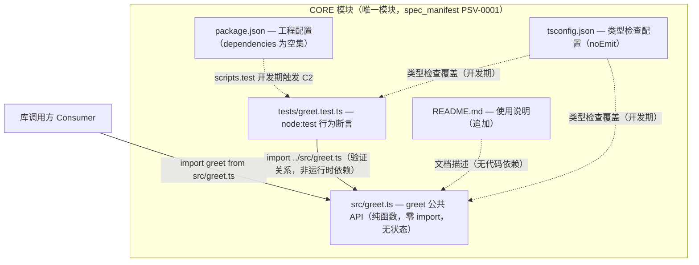

# Project Architecture Candidate — WI-0001（Greeting Library 首份正式项目架构）

## 候选绑定与基线事实

- Work Item: WI-0001（feature_spec / requirement_change_path）
- 模块归属: CORE（spec_manifest.json PSV-0001 唯一已声明模块，default_module=CORE）
- implementation_baseline_id: `sha256:8f8ac52aeb32950630565ea6fa66a62d4fe0afd6acb9ec26635a509b958b2722`（Runtime 基线文件：`.specforge/work-items/WI-0001/implementation_baseline.json`，captured_at: 2026-10-25T05:23:36.211Z）
- 基线逐项核对（已读取 `.specforge/work-items/WI-0001/implementation_baseline.json` 并逐项核对）：
  - `README.md` **既有**（123 bytes，sha256:757ee94ea46933c3dd7092c04d15a32546a3f54e609b9c6e66351eeafe8fdf40）→ 本 WI 为**追加式修改**（在既有文档基线上追加使用说明，非推倒重建）；
  - `src/greet.ts`、`tests/greet.test.ts`、`package.json`、`tsconfig.json` 基线 matched_files 为空 → 本 WI **新建**（项目首个正式功能代码、测试与工程配置）；
  - 既有占位观测：`.specforge/project/architecture.md`（"> TODO: 由首次 intake 阶段填充"）、`modules/CORE/design.md`（同占位）、`modules/CORE/module.json`（active、无 code_paths）。
- 本候选是项目**首份正式 Project Architecture**：当前正式架构为占位符，无既有正式架构内容被替换或废弃。
- analysis_scope: system_governance（与 design.candidate.md 一致，触发依据：本 WI 创建首份正式架构/数据模型/模块契约）

## 1. 架构总览

Greeting Library 是**单一模块（CORE）、单一公共函数（greet）、零运行时依赖**的 TypeScript 库。全部 5 条计划代码路径归属 CORE；无跨模块调用、无服务进程、无持久化、无网络面。以下组件清单与基线一一对应，不含任何虚构组件：

| # | 组件 | 路径 | 基线状态 | 架构角色（"我是 X"） |
| --- | --- | --- | --- | --- |
| C1 | greet 公共 API | `src/greet.ts` | 新建 | 我是库的唯一运行时公共入口：导出 `greet(name: string): string` |
| C2 | 行为验证套件 | `tests/greet.test.ts` | 新建 | 我是两条行为规则的机器可复核断言集合（Node 内置 node:test） |
| C3 | 使用说明 | `README.md` | 既有（追加修改） | 我是面向库调用方的调用方式与两种返回行为文档 |
| C4 | 工程配置 | `package.json` | 新建 | 我是开发期入口与 test script 声明，并显式声明零运行时依赖 |
| C5 | 类型检查配置 | `tsconfig.json` | 新建 | 我是开发期 TypeScript 类型检查配置（noEmit），不进入运行时路径 |

## 2. 架构图（显式依赖）

显式依赖结论（A2 自检）：**运行时依赖图仅一条边**（CALLER → C1）；C1 自身零 import（自包含纯函数）；C2→C1 是验证依赖；C3/C4/C5 与代码之间是文档/工具链关系，不构成运行时调用边。图中所有箭头与上表组件一一对应，无未画出的调用。

## 3. 架构规则

### ARCH-CORE-001 单一模块库架构

- **refs**: [REQ-CORE-001, DD-CORE-001]
basis_refs: [FACT-2（spec_manifest PSV-0001 唯一模块 CORE）, IMPACT-1（5 条 planned_code_paths 全部归属 CORE）, CLS-1（module_boundary_changed=false）]
constrained_by: 无上层约束（本规则为项目级根约束）

规则内容：项目运行时结构由唯一模块 CORE 构成；`src/greet.ts`、`tests/greet.test.ts`、`README.md`、`package.json`、`tsconfig.json` 全部登记于 CORE 的 code_paths（见 module.candidate.json）；不新增模块、不移动模块边界。任何跨模块或新模块诉求必须另立 Work Item 走治理流程，不得在本架构内私扩。

### ARCH-CORE-002 零运行时依赖架构

- **refs**: [REQ-CORE-006, DD-CORE-003, DD-CORE-004]
basis_refs: [CONSTRAINT-2（不假设网络/npm registry/CI/包管理器可用）, FACT-3（隔离验收运行）, PE-1（prod-environment：无外部服务依赖）]

规则内容：库运行时路径（`src/`）不得 import/require 任何第三方包、网络资源或外部服务；`package.json` 运行时 dependencies 为空集；工具链组件（Node 内置 node:test 测试运行器、可选 tsc 类型检查）仅属开发期，不计入运行时依赖。

### ARCH-CORE-003 纯函数行为面

- **refs**: [REQ-CORE-001, REQ-CORE-002, REQ-CORE-003, DD-CORE-001, DD-CORE-002]
basis_refs: [CLS-1（data_semantics_changed=false）, FACT-3（"No production data"）, DATA-CORE-004（无持久化负声明）]

规则内容：CORE 公共行为面有且仅有一个导出函数 `greet`；其为无状态、无副作用、无 I/O、无持久化的纯函数映射（输入定义域 → 输出模板，语义见 Data Model Candidate DATA-CORE-001/DATA-CORE-002）；除两条定义行为外无任何其他承诺（不含额外输入分支，CONSTRAINT-1）。

### ARCH-CORE-004 工具链与运行时隔离

- **refs**: [REQ-CORE-004, REQ-CORE-006, DD-CORE-003]
basis_refs: [CONSTRAINT-2, UNKNOWN-2（Node/TS 版本未取证——工具链风险只允许落在开发期）, HOST-1（主机观测 node 24.19.0 / npm 11.17.0 / win32）]

规则内容：测试执行采用零安装路径（Node 内置 node:test 运行器 + Node 内置 type stripping 直接运行 `.ts`，不引入任何需要安装的开发期第三方依赖）；`tsconfig.json` 仅用于类型检查（noEmit），不产生构建产物依赖；工具链版本风险（D-2）由开发期缓解策略与批准后验证阶段取证承接，不得转化为运行时约束或运行时依赖。

## 4. Out of Scope

- 不含任何第二模块、服务进程、数据库、网络面、CI/CD 与发布流水线（依据：requirements.candidate.md 范围外 #5/#7/#8）。
- 不含可配置问候模板、国际化、额外输入分支（范围外 #1/#2/#3）。
- 不修改 SpecForge 治理链本身；治理能力裁决（capability_verdict）见 design.candidate.md 第 4 节，不在架构层展开。

## 5. Assumptions

- 假设主机观测到的 Node 24.19.0（HOST-1）代表可用运行时基线；项目内具体版本由批准后实现/验证阶段以真实运行证据确认（D-2，requires_runtime_confirmation）。
- 假设 README.md 既有内容在合并后保留，使用说明为既有内容之后的追加章节（基线 sha256:757ee94e 锚定；DD-CORE-005）。
- 假设隔离验收环境无并发与性能诉求（FACT-3），本架构不含容量设计。

## 系统治理分析（analysis_scope: system_governance）

### Problem Understanding

本 WI 的直接问题是为 greenfield Greeting Library 首建正式规格对象，而非修复既有缺陷。症状层面是项目级 architecture.md / design.md / module.json 均为占位符；直接问题是五层规格对象（architecture、data model、module definition、module contract、module design）需要一次性首建并保持相互一致。无根因假设待证事实：唯一待证项是工具链版本（D-2/UNKNOWN-2），已限定在开发期由验证阶段取证，不影响架构层设计。

### Existing Architecture Analysis

真实架构如本文第 1-2 节所述：单一 CORE 模块、运行时依赖图仅 CALLER→C1 一条边，`src/greet.ts` 为零 import 自包含纯函数。状态权威方面，`.specforge/project/**` 是规格真相源，本 WI 候选位于 `candidates/project/**`，须经 Gate、User Decision、Merge Runner 才能进入正式规格；写入边界由 Runtime 受控 artifact writer 与 Write Guard 承载。`implementation_baseline.json`（snapshot sha256:8f8ac52a…）锚定了 1 个既有文件（README.md 追加）与 4 个新建文件的事实基线。

### Governance Classification

本 WI 属于规格治理层的首建事件，不触及 SpecForge Runtime、Agent、Tool 或 Audit 层的变更。具体落在 Contract 层（首次登记 CORE Module Contract 的 INV/PI 条目）与 Standard/规格层（首份 architecture.md、data_model.md、module design）。不涉及状态机、权限或跨模块协议变更，因此治理范围收敛于当前 feature_spec / requirement_change_path 的正常 Candidate 流程。

### Existing Capability Assessment

按七层评估：Standard 层——feature_spec 生命周期与 Candidate/Gate/Merge 流程可直接承载首建规格；Contract 层——sf_contract_register 与 Module Contract canonical schema 已可表达 INV-CORE-002、PI-CORE-001；Skill/Agent 层——sf-design 角色、产物类型与 file_type 枚举齐备；Tool 层——sf_artifact_write 支持 candidate_architecture / candidate_data_model / candidate_module_definition / candidate_module_contract 全部所需类型；Runtime 层——implementation_baseline、candidate_manifest 物化、Gate Runner 均已存在；Audit 层——changed_files_audit 与 handoff 机制可用。结论：无需任何扩展即可完成本 WI 的分析与治理。

### Solution Strategy

最小方案即当前候选包本身：在同一个 WI 内提交五层规格候选（architecture、data_model、module definition、module contract、module design），5 条 planned_code_paths 全部归属既有 CORE 模块，不新增模块、不新增治理能力。明确不改：不修改 SpecForge 治理链、不引入构建产物依赖、不为 E0/E1 之外的输入增加行为分支（CONSTRAINT-1）。DATA-CORE-003 的 name 原样保留语义由 CORE Module Contract 的 INV-CORE-002 与 PI-CORE-001 行为承诺承载，为普通契约对应关系而非 constrained_by 依赖。

### Impact Analysis

受影响契约：CORE Module Contract 新增 INV-CORE-002、PI-CORE-001（首建，无既有消费者）。受影响流程：Candidate → Gate（schema/trace/spec_consistency）→ User Decision → Merge 进入 `.specforge/project/**`。受影响产物：本 WI 五个候选文件及由 Runtime 物化的 candidate_manifest。兼容性：项目此前无正式规格，无既有消费者需要迁移；README.md 为追加式修改，既有 123 bytes 内容保留。回归范围：仅 CORE 模块内部，两条行为规则（T1/T2）与 name 原样保留性质的测试即完整回归面。

### Verification Plan

静态契约验证：Gate 对候选文件做 schema、path policy、trace（REQ→DD）与 spec_consistency 检查。单元/行为验证：`tests/greet.test.ts` 以 node:test 断言两条行为规则——非空 name 返回 `"Hello, " + name + "!"`（DATA-CORE-002 T1），空 name 返回常量 `"Hello, world!"`（T2），并覆盖纯空白字符串按 E1 处理与 name 逐字符原样保留（CP-004 对应 INV-CORE-002）。集成/E2E：运行时依赖图仅一条边，行为验证即端到端面；无网络、无持久化，故无集成拓扑。live acceptance：批准后在隔离验收环境以零安装路径（node:test + type stripping）运行测试套件取得真实通过证据；本文写作时测试尚未运行，不声称任何已通过结果。capability_verdict: reuse_existing
