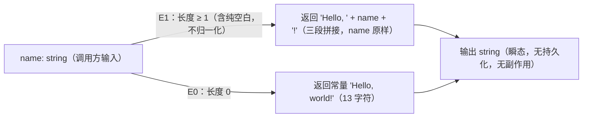

# Data Model Candidate — WI-0001（Greeting Library 首份正式数据模型）

## 候选绑定

- Work Item: WI-0001（feature_spec / requirement_change_path）
- 模块归属: CORE（spec_manifest.json PSV-0001 唯一已声明模块）
- implementation_baseline_id: `sha256:8f8ac52aeb32950630565ea6fa66a62d4fe0afd6acb9ec26635a509b958b2722`（Runtime 基线文件：`.specforge/work-items/WI-0001/implementation_baseline.json`，captured_at: 2026-10-25T05:23:36.211Z）
- 基线核对（按 `.specforge/work-items/WI-0001/implementation_baseline.json` 枚举基线事实：README.md 既有 123 bytes sha256:757ee94ea46933c3dd7092c04d15a32546a3f54e609b9c6e66351eeafe8fdf40 → 追加式修改；package.json/src/greet.ts/tests/greet.test.ts/tsconfig.json matched_files 为空 → 新建）：本数据模型描述的对象（greet 输入/输出字符串）对应的实现文件 `src/greet.ts` 基线缺失（新建）；项目无任何既有数据模型或持久化结构（greenfield 首建）。

## 1. 数据架构声明（如实）

本库**无持久化存储**：无数据库、无表、无文件持久化、无外部服务数据（FACT-3："No production data"；CLS-1：data_semantics_changed=false；PE-1：无数据库/外部服务）。本数据模型刻画的对象是 `greet` 函数的**内存瞬态字符串数据**：输入 `name` 与输出问候字符串。本候选如实声明"无持久化"，不虚构任何表结构、共享数据、历史/审计/汇总结构、事务边界或索引。

## 2. 数据规则

### DATA-CORE-001 greet 输入定义域

- **refs**: [REQ-CORE-002, REQ-CORE-003, DD-CORE-002]
basis_refs: [UQ-2, UQ-3, CONSTRAINT-1, requirements.candidate.md 定义域边界（Must）]
constrained_by: ARCH-CORE-003（纯函数行为面）

规则内容：输入 `name: string` 的定义域为两个等价类，且仅此两个：

| 等价类 | 定义 | 映射目标 |
| --- | --- | --- |
| E0 空名称 | `string.length === 0`，即 `""` | DATA-CORE-002 T2 |
| E1 非空名称 | `string.length >= 1` 的任意字符串（**含纯空白字符构成的字符串**，按 E1 处理，禁止 trim/归一化） | DATA-CORE-002 T1 |

长度判定采用 JavaScript/TypeScript string 语义（UTF-16 code unit 计数）：`""` 恒为长度 0，任何非空字符串长度 ≥ 1，空/非空划分无歧义。域外值（null、undefined、非 string 类型）：行为未定义，不属于本数据模型承诺（CONSTRAINT-1：不得为其编写分支或设定预期）。

### DATA-CORE-002 greet 输出模板语义

- **refs**: [REQ-CORE-002, REQ-CORE-003, DD-CORE-001, DD-CORE-002]
basis_refs: [UQ-2, UQ-3]
constrained_by: ARCH-CORE-003

规则内容：输出恒为 `string`，由且仅由以下两个精确模板之一产生：

| 模板 | 触发等价类 | 语义 |
| --- | --- | --- |
| T1 个性化问候 | E1 | `"Hello, " + name + "!"` —— 固定前缀 `"Hello, "`（Hello + 逗号 + 一个空格，6 字符）、name 原文、固定后缀 `"!"` 三段依序拼接 |
| T2 默认问候 | E0 | 精确常量 `"Hello, world!"`（13 字符：大写 H、小写 world、逗号后一个空格、结尾感叹号） |

### DATA-CORE-003 name 不变式（数据完整性）

- **refs**: [REQ-CORE-002]
basis_refs: [UQ-2（name 原样保留、不做增删改写）, AC-CORE-005, AC-CORE-006]
constrained_by: ARCH-CORE-003（纯函数行为面）
- **契约对应**: name 原样保留语义另由 CORE Module Contract 的 INV-CORE-002 与 PI-CORE-001 行为承诺承载

规则内容：`name` 在输出中**逐字符原样保留**：禁止 trim、大小写变换、Unicode 归一化、截断或任何改写。E1 输出的中间段与输入 name 逐字符相等（可复核性质见 design.candidate.md CP-004）。

### DATA-CORE-004 无持久化与瞬态性声明（显式负声明）

- **refs**: [REQ-CORE-006]
basis_refs: [FACT-3, CLS-1（data_semantics_changed=false）, PE-1]
constrained_by: ARCH-CORE-002（零运行时依赖架构）

规则内容：全部数据为调用栈内瞬态 string；无持久化实体、无共享数据、无历史/审计/汇总结构、无事务一致性边界、无索引与性能设计。本条为**显式负声明**：未来引入任何持久化或跨调用状态即违反本数据模型，必须另立 Work Item 走治理变更。

## 3. 数据流

## 4. Out of Scope

- 不定义任何 schema、迁移、版本化或序列化格式（无持久化，无从谈起）。
- 不定义 E0/E1 之外的输入类别（null/undefined/非 string 未定义，CONSTRAINT-1）。
- 不定义多语言/可配置模板数据（范围外 #2/#3）。

## 5. Assumptions

- 假设运行时为标准 Node.js string 语义（UTF-16 code unit 长度），E0/E1 划分无实现歧义。
- 假设无持久化状态在本库生命周期内维持（FACT-3）；任何反例必须另立 WI。
