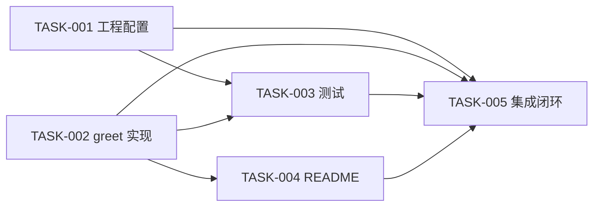

# Tasks Candidate — WI-0001 / CORE（Greeting Library 首个功能）

## 候选绑定

- Work Item: WI-0001（feature_spec / requirement_change_path）
- 模块归属: CORE（spec_manifest.json PSV-0001 唯一已声明模块，default_module=CORE）
- implementation_baseline_id: `sha256:8f8ac52aeb32950630565ea6fa66a62d4fe0afd6acb9ec26635a509b958b2722`（本候选逐字绑定；任务 create/modify 标记与基线逐文件一致）
- 上游输入（只读）：`intake.md`、`trigger_result.json`、`candidates/project/modules/CORE/requirements.candidate.md`（REQ-CORE-001～REQ-CORE-006 / AC-CORE-001～AC-CORE-018 已冻结）、`candidates/project/modules/CORE/design.candidate.md`（DD-CORE-001～DD-CORE-006 已冻结）、`candidates/project/architecture.candidate.md`（ARCH-CORE-001～004）、`candidates/project/data_model.candidate.md`（DATA-CORE-001～004）、`candidates/project/modules/CORE/module.candidate.json`（CORE code_paths 5 条）、`candidates/project/modules/CORE/contracts.candidate.json`（PI-CORE-001、INV-CORE-001～003）
- 配置依据：`project-rules.md`（主语言 TypeScript；零依赖优先；node:test 优先；最小工程配置随首个功能受控创建）、`prod-environment.md`（无生产部署；Node 版本未取证；win32；无外部服务依赖）
- 任务编号约定：短编号 TASK-001～TASK-005 与规范 ID `TASK-WI-0001-001`～`TASK-WI-0001-005` 一一对应；追溯统一使用规范 ID。
- 引用承载说明：Contract/Architecture/Data 层引用（PI-CORE-*、INV-CORE-*、ARCH-CORE-*、DATA-CORE-*）按 task-document/v1 不进入结构化 refs，在每任务 context_block 的 **Refs** 行中以文本承载。

## D18 声明（流程硬约束）

本文档全部 `verification_commands` 均为**声明性验证命令**，供批准后的实现/验证阶段在合法执行边界内使用。本阶段（candidate_preparing）**未执行任何命令、未运行任何测试、未取得任何运行证据**；本文档不含任何"已运行/已通过"表述（AC-CORE-012 / CONSTRAINT-1）。运行与通过证据（EVREQ-2A/3A/4B 等）属于批准后验证阶段。

## 承接的上游约束

- CONSTRAINT-1：不实现额外输入分支（null/undefined/非 string 不编写任何分支、校验或抛错；纯空白字符串按非空规则直接处理，禁止 trim/归一化）。
- CONSTRAINT-2：不引入任何第三方依赖（运行时与开发期均零安装）；不假设 npm registry、网络、CI、外部执行器可用。
- Impact Scope 硬界：全部任务 `allowed_write_files` 之和恰等于 `impact_scope.planned_code_paths` 的 5 条，不多不少，不扩大；每条路径唯一映射模块 CORE。

## 基线逐文件状态（T2A 对账，依据 implementation_baseline.json）

| 计划代码路径 | 基线状态 | 任务操作 | 承接任务 |
| --- | --- | --- | --- |
| README.md | 既有（123 bytes，sha256:757ee94ea46933c3dd7092c04d15a32546a3f54e609b9c6e66351eeafe8fdf40） | 修改（追加式，既有内容逐字节保留） | TASK-WI-0001-004 |
| package.json | 基线缺失（matched_files 为空） | 创建（TASK-005 仅在 D-2 降级触发时受控微调 scripts.test） | TASK-WI-0001-001（创建）、TASK-WI-0001-005（降级微调，主路径零变更） |
| tsconfig.json | 基线缺失 | 创建 | TASK-WI-0001-001 |
| src/greet.ts | 基线缺失 | 创建 | TASK-WI-0001-002 |
| tests/greet.test.ts | 基线缺失 | 创建 | TASK-WI-0001-003 |

Current Implementation 总结（全候选共用）：CORE 模块当前**无既有业务源代码、无既有测试、无既有工程配置**（项目首个正式功能：5 条计划路径中 README.md 为既有文件·追加式修改，其余 4 条为新建）；README.md 是唯一既有交付文件。已确认依据：CODE_OBSERVED（implementation_baseline.json，snapshot sha256:8f8ac52a…）+ PROJECT_SPEC（candidates/*）+ DESIGN（DD-CORE-001～DD-CORE-006）。

## 任务总览、批次与依赖

| 规范 ID | 短编号 | 名称 | 主 DD | allowed_write_files | depends_on | 批次 |
| --- | --- | --- | --- | --- | --- | --- |
| TASK-WI-0001-001 | TASK-001 | 创建最小工程配置 | DD-CORE-004（+DD-CORE-003 scripts.test） | package.json, tsconfig.json | 无 | 1（可并行） |
| TASK-WI-0001-002 | TASK-002 | 实现 greet 纯函数 | DD-CORE-001, DD-CORE-002 | src/greet.ts | 无 | 1（可并行） |
| TASK-WI-0001-003 | TASK-003 | 编写行为断言测试 | DD-CORE-006（+DD-CORE-003） | tests/greet.test.ts | TASK-WI-0001-001, TASK-WI-0001-002 | 2（可并行） |
| TASK-WI-0001-004 | TASK-004 | README 追加使用说明 | DD-CORE-005 | README.md | TASK-WI-0001-002 | 2（可并行） |
| TASK-WI-0001-005 | TASK-005 | 集成闭环验证（T2C） | DD-CORE-001/DD-CORE-003/DD-CORE-006 链路 | package.json（仅 D-2 降级微调；主路径零写入） | TASK-WI-0001-001～004 | 3（串行收口） |

批次说明：批次 1（TASK-001 × TASK-002）与批次 2（TASK-003 × TASK-004）内部写文件零交集、无隐性依赖，可并行；TASK-005 为 Integration Closure Task（T2C），串行收口验证多任务链路真实接通（其 package.json 写入面仅在与 TASK-001 串行依赖下生效，无并行重叠）。

---

### TASK-WI-0001-001（TASK-001）创建最小工程配置 package.json 与 tsconfig.json

**context_block**（executor 必读）：
- **What**: 新建根级 `package.json` 与 `tsconfig.json` 两个最小工程配置文件。`package.json` 字段级形态（DD-CORE-004 逐字执行）：`name: "greeting-library"`、`version: "0.1.0"`、`private: true`、`type: "module"`、`scripts.test: "node --test tests/greet.test.ts"`、`dependencies: {}`（显式空对象）；**不设** `main`/`exports`/`devDependencies`/构建脚本。`tsconfig.json`：`compilerOptions` 含 `target: "ES2022"`、`module: "NodeNext"`、`moduleResolution: "NodeNext"`、`strict: true`、`noEmit: true`、`allowImportingTsExtensions: true`；`include: ["src/**/*.ts", "tests/**/*.ts"]`。
- **Why**: 为 REQ-CORE-001 的签名静态复核（AC-CORE-002）提供类型检查配置；为 REQ-CORE-004 提供唯一测试入口声明（`scripts.test`，DD-CORE-003 主路径）；以 `dependencies: {}` 显式空对象作为 REQ-CORE-006 零运行时依赖的可检查配置证据（EVREQ-6A，INV-CORE-003）。
- **Refs**（完整引用链，文本承载）：DD-CORE-004（最小工程配置设计）、DD-CORE-003（scripts.test 唯一测试入口与零安装路径）；约束契约 INV-CORE-003（零运行时依赖）、ARCH-CORE-002（零运行时依赖架构）、ARCH-CORE-004（工具链与运行时隔离）。
- **Current Implementation**: 两文件基线缺失（implementation_baseline.json matched_files 均为空）→ 全部新建；项目此前无任何工程配置（BL-1/FACT-1）。已确认依据：CODE_OBSERVED（基线）+ DESIGN（DD-CORE-004）。
- **Constraints**:
  - 不引入任何第三方依赖（运行时与 devDependencies 均零安装，CONSTRAINT-2/AC-CORE-018）。
  - `noEmit: true` 与 `allowImportingTsExtensions: true` 必须同时出现（配套合法组合，支撑测试文件显式 `.ts` import）。
  - tsconfig 仅用于开发期类型检查，不产生构建产物、不构成任何执行前置（ARCH-CORE-004 工具链与运行时隔离）。
  - 遵守 project-rules：最小工程配置随首个功能任务受控创建；风格为标准 JSON 两空格缩进。
- **Steps**（执行步骤）:
  1. 新建 `package.json`，按 What 中字段级形态逐字段写入（顺序：name、version、private、type、scripts、dependencies）。
  2. 自查 `dependencies` 为显式空对象 `{}`，无 `devDependencies` 键。
  3. 新建 `tsconfig.json`，写入 `compilerOptions` 六项与 `include` 两项。
  4. 自查两文件为合法 JSON（可用 Read 工具复核结构）。
- **Done When Code**: `package.json` 与 `tsconfig.json` 存在于项目根，字段与 DD-CORE-004 逐项一致。
- **Done When Behavior**: `scripts.test` 即 DD-CORE-003 主路径命令；类型检查配置覆盖 src/ 与 tests/ 且不产出构建产物；零运行时依赖在配置面显式成立。
- **Done When Evidence**: 下方 unit 命令全部以退出码 0 通过（批准后实现阶段的合法执行边界内取得；本阶段仅为声明）。

- **refs**: [REQ-CORE-001, REQ-CORE-004, REQ-CORE-006, DD-CORE-004, DD-CORE-003]
- **depends_on**: []
- **allowed_write_files**: [package.json, tsconfig.json]
- **forbidden_files**: [src/greet.ts, tests/greet.test.ts, README.md, .specforge/work-items/**, .specforge/project/**, .specforge/config/**]
- **expected_file_changes**: [package.json（新建，约 10 行）, tsconfig.json（新建，约 10 行）]
- **verification_commands**:
  - unit:
    - `test -f package.json && test -f tsconfig.json`
    - `grep -c '"dependencies": {}' package.json`
    - `grep -c '"test": "node --test tests/greet.test.ts"' package.json`
    - `grep -c '"type": "module"' package.json`
    - `grep -cE '"noEmit": true|"allowImportingTsExtensions": true' tsconfig.json`
- **verification_evidence_expected**:
  | command | expected_exit_code | expected_output_pattern | evidence_type |
  | --- | --- | --- | --- |
  | `test -f package.json && test -f tsconfig.json` | 0 | 无输出 | command_exit |
  | `grep -c '"dependencies": {}' package.json` | 0 | 含 1 | command_output |
  | `grep -c '"test": "node --test tests/greet.test.ts"' package.json` | 0 | 含 1 | command_output |
  | `grep -c '"type": "module"' package.json` | 0 | 含 1 | command_output |
  | `grep -cE '"noEmit": true|"allowImportingTsExtensions": true' tsconfig.json` | 0 | 含 2 | command_output |
- **out_of_scope**: 不实现 greet 函数；不编写测试；不修改 README；不新增 main/exports/构建脚本/CI 配置；不运行任何测试命令（`node --test` 属批准后验证阶段）。
- **验收对照**: AC-CORE-011（scripts.test 入口形态）、AC-CORE-016（dependencies 为空集）、AC-CORE-018（工具链仅开发期、零安装）、AC-CORE-002（tsconfig 承载签名静态类型检查路径）。

---

### TASK-WI-0001-002（TASK-002）实现 src/greet.ts 纯函数导出

**context_block**（executor 必读）：
- **What**: 新建 `src/greet.ts`，提供**唯一**具名导出 `greet`，签名 `export function greet(name: string): string`（PI-CORE-001 逐字实现）。函数体有且仅有两个行为分支（DD-CORE-002）：`name === ""`（长度 0）→ 返回精确常量 `"Hello, world!"`（13 字符：大写 H、小写 world、逗号后一个空格、结尾感叹号）；否则（长度 ≥ 1，含纯空白字符串）→ 返回 `"Hello, " + name + "!"` 三段依序拼接，name 逐字符原样保留。零 import、无状态、无副作用、无 I/O、不抛出异常（定义域内）。
- **Why**: 实现用户结果的核心行为契约：REQ-CORE-001（导出契约）、REQ-CORE-002（非空名称个性化问候）、REQ-CORE-003（空名称默认问候）；同时以零 import 源码事实支撑 REQ-CORE-006/INV-CORE-003。
- **Refs**（完整引用链，文本承载）：DD-CORE-001（公共 API 设计，接口定义见 design.candidate.md §5.2 DD-CORE-001）、DD-CORE-002（两条行为规则与定义域分支）；约束契约 PI-CORE-001、INV-CORE-001、INV-CORE-002、DATA-CORE-001、DATA-CORE-002、DATA-CORE-003、ARCH-CORE-003。
- **Current Implementation**: `src/` 目录与 `src/greet.ts` 基线缺失（matched_files 为空）→ 全新建；CORE 当前无任何业务源代码（BL-1/FACT-1）。已确认依据：CODE_OBSERVED（基线）+ DESIGN（DD-CORE-001/002）+ PROJECT_SPEC（PI-CORE-001/DATA-CORE-001～003）。
- **Constraints**:
  - 禁止为 null/undefined/非 string 编写任何分支、校验、抛错（CONSTRAINT-1；域外行为在 PI-CORE-001.undefined_behavior 中明确未定义）。
  - 禁止 trim、大小写变换、Unicode 归一化、截断或任何对 name 的改写（DATA-CORE-003/INV-CORE-002）。
  - 文件零 import（自包含纯函数；EVREQ-6A/INV-CORE-003 源码面）。不引入新依赖（CONSTRAINT-2）。
  - 仅使用可擦除 TypeScript 语法（类型标注），不使用 enum/namespace/参数属性（ARCH-CORE-004 type stripping 路径要求）。
  - 函数实现不依赖 package.json/tsconfig.json 的存在（文件系统独立；二者仅属开发期工具链）。
- **Steps**（执行步骤）:
  1. 新建 `src/greet.ts`。
  2. 写入唯一具名导出 `greet(name: string): string` 与两个行为分支（空字符串 → 常量；其余 → 三段拼接）。
  3. 自查：无 import 语句、无类型分支、无 trim/变换、无 throw、无 console/I/O。
  4. 用 Read 复核签名逐字符为 `export function greet(name: string): string`。
- **Done When Code**: `src/greet.ts` 存在，恰一个具名导出 `greet`，签名精确匹配，函数体恰两个分支，零 import。
- **Done When Behavior**: E0（`""`）→ `"Hello, world!"`；E1（任意长度 ≥ 1 字符串，含纯空白）→ `"Hello, " + name + "!"`（name 原样）；定义域内不抛出、无副作用。
- **Done When Evidence**: 下方 unit 命令全部退出码 0（静态证据，批准后实现阶段取得）；行为层运行证据由 TASK-WI-0001-003/005 的断言运行提供（EVREQ-2A/3A/4B，批准后验证阶段）。

- **refs**: [REQ-CORE-001, REQ-CORE-002, REQ-CORE-003, DD-CORE-001, DD-CORE-002]
- **depends_on**: []
- **allowed_write_files**: [src/greet.ts]
- **forbidden_files**: [package.json, tsconfig.json, tests/greet.test.ts, README.md, .specforge/work-items/**, .specforge/project/**, .specforge/config/**]
- **expected_file_changes**: [src/greet.ts（新建，< 20 行）]
- **verification_commands**:
  - unit:
    - `test -f src/greet.ts`
    - `grep -c "export function greet(name: string): string" src/greet.ts`
    - `grep -c "Hello, world!" src/greet.ts`
    - `! grep -qE "^import |^import\{|require\(" src/greet.ts`
- **verification_evidence_expected**:
  | command | expected_exit_code | expected_output_pattern | evidence_type |
  | --- | --- | --- | --- |
  | `test -f src/greet.ts` | 0 | 无输出 | command_exit |
  | `grep -c "export function greet(name: string): string" src/greet.ts` | 0 | 含 1 | command_output |
  | `grep -c "Hello, world!" src/greet.ts` | 0 | 含 1 | command_output |
  | `! grep -qE "^import |^import\{|require\(" src/greet.ts` | 0 | 无输出（零 import 事实） | command_exit |
- **out_of_scope**: 不实现额外输入分支（null/undefined/非 string/纯空白特殊处理/trim）；不写测试；不改工程配置与 README；不做国际化/可配置模板；不运行任何命令。
- **验收对照**: AC-CORE-001、AC-CORE-002（+AC-CORE-003 反向判定）、AC-CORE-004、AC-CORE-005（+AC-CORE-006）、AC-CORE-007、AC-CORE-008（+AC-CORE-009）。

---

### TASK-WI-0001-003（TASK-003）编写 tests/greet.test.ts 行为断言套件

**context_block**（executor 必读）：
- **What**: 新建 `tests/greet.test.ts`，使用 Node 内置 `node:test` 的 `test()` 组织断言、`node:assert/strict` 的 `strictEqual` 做严格相等断言，实现 DD-CORE-006 断言清单：A1 `greet("Ada")` 严格等于 `"Hello, Ada!"`；A2 `greet("Grace")` 严格等于 `"Hello, Grace!"`；A3 `greet("")` 严格等于 `"Hello, world!"`；A4 纯空白名称（如 `"  "`）严格等于 `"Hello, " + name + "!"` 拼接形态。对被测对象的引用使用显式 `.ts` 说明符：`import { greet } from "../src/greet.ts"`（type stripping 要求，与 tsconfig `allowImportingTsExtensions` 配套）。
- **Why**: 交付 REQ-CORE-004 的自动化测试：A1/A2 满足 EVREQ-2A"≥ 2 个互不相同非空名称"，A3 满足 EVREQ-3A，A4 固化 INV-CORE-002"纯空白按非空规则处理、不归一化"；测试以真实 import 消费公共 API（EVREQ-1B 最小集成面）。
- **Refs**（完整引用链，文本承载）：DD-CORE-006（断言与验证钩子设计，断言清单 A1–A4）、DD-CORE-003（node:test + node:assert/strict 零安装路径）；约束契约 PI-CORE-001、INV-CORE-001、INV-CORE-002、ARCH-CORE-004。
- **Current Implementation**: `tests/` 目录与文件基线缺失 → 全新建；项目无既有测试（BL-1）。被测对象 `src/greet.ts` 由 TASK-WI-0001-002 创建（本任务前置依赖）；测试入口声明 `scripts.test` 由 TASK-WI-0001-001 创建。已确认依据：CODE_OBSERVED（基线）+ DESIGN（DD-CORE-006/DD-CORE-003）。
- **Constraints**:
  - 仅使用 Node 内置模块（`node:test`、`node:assert/strict`）；零 devDependencies、零安装步骤（DD-CORE-003 D-1 裁决、CONSTRAINT-2）。
  - 仅使用可擦除 TypeScript 语法；import 说明符必须带 `.ts` 扩展名。
  - 断言必须恰好覆盖 A1–A4 四条，不新增对域外输入（null/undefined/非 string）的断言（CONSTRAINT-1）。
  - 本任务只编写测试文件；**不得运行测试**（运行与取证属批准后验证阶段，AC-CORE-012）。
- **Steps**（执行步骤）:
  1. 新建 `tests/greet.test.ts`。
  2. 写入 `import { test } from "node:test"`、`import assert from "node:assert/strict"`、`import { greet } from "../src/greet.ts"`。
  3. 写入 A1–A4 四条 `test()` + `assert.strictEqual(...)` 断言（断言值逐字符按 What 清单）。
  4. 自查断言计数与清单一致、无域外输入断言、无第三方 import。
- **Done When Code**: `tests/greet.test.ts` 存在，含 4 条 strictEqual 断言（A1–A4），import 形态符合 type stripping 要求。
- **Done When Behavior**: 该套件在 `node --test tests/greet.test.ts` 下可加载并执行（批准后验证阶段以真实运行输出证明全部断言通过，EVREQ-4B；主路径 Node ≥ 23.6，降级链见 DD-CORE-003 D-2）。
- **Done When Evidence**: 下方 unit 命令（静态存在性）全部退出码 0；integration 命令 `node --test tests/greet.test.ts` 在批准后验证阶段取得退出码 0 的真实运行输出（本阶段仅为声明，不声称已运行）。

- **refs**: [REQ-CORE-002, REQ-CORE-003, REQ-CORE-004, DD-CORE-006, DD-CORE-003]
- **depends_on**: [TASK-WI-0001-001, TASK-WI-0001-002]
- **allowed_write_files**: [tests/greet.test.ts]
- **forbidden_files**: [src/greet.ts, package.json, tsconfig.json, README.md, .specforge/work-items/**, .specforge/project/**, .specforge/config/**]
- **expected_file_changes**: [tests/greet.test.ts（新建，< 30 行）]
- **verification_commands**:
  - unit:
    - `test -f tests/greet.test.ts`
    - `grep -c "node:test" tests/greet.test.ts`
    - `grep -c "node:assert/strict" tests/greet.test.ts`
    - `grep -c "strictEqual" tests/greet.test.ts`
  - integration:
    - `node --test tests/greet.test.ts`
- **verification_evidence_expected**:
  | command | expected_exit_code | expected_output_pattern | evidence_type |
  | --- | --- | --- | --- |
  | `test -f tests/greet.test.ts` | 0 | 无输出 | command_exit |
  | `grep -c "node:test" tests/greet.test.ts` | 0 | 含 1 | command_output |
  | `grep -c "node:assert/strict" tests/greet.test.ts` | 0 | 含 1 | command_output |
  | `grep -c "strictEqual" tests/greet.test.ts` | 0 | 含 4（A1–A4） | command_output |
  | `node --test tests/greet.test.ts` | 0 | `4 pass`（或等价全部通过输出） | test_output |
  注：integration 行为**声明性预期**，仅在批准后验证阶段于合法执行边界内运行取证（EVREQ-4B；AC-CORE-012 禁止本阶段声称已运行）。
- **out_of_scope**: 不修改 greet 实现；不改工程配置与 README；不新增域外输入断言；不引入任何测试框架第三方依赖；不运行测试（本阶段）。
- **验收对照**: AC-CORE-010（断言清单覆盖两条行为，A1/A2/A4 → REQ-CORE-002、A3 → REQ-CORE-003）、AC-CORE-011（可运行形态，运行取证在 TASK-005/验证阶段）、AC-CORE-012（本任务全程无"已运行"表述）。

---

### TASK-WI-0001-004（TASK-004）README.md 追加 greet 使用说明

**context_block**（executor 必读）：
- **What**: 对既有 `README.md` 实施**追加式修改**：保留既有标题 `# Greeting Library` 与项目性质描述行（既有 123 bytes，基线 sha256:757ee94ea46933c3dd7092c04d15a32546a3f54e609b9c6e66351eeafe8fdf40 逐字节锚定），在既有内容之后追加一个使用说明章节，必须含三要素（DD-CORE-005）：（1）调用方式——从 `./src/greet.ts` import `greet` 的示例与签名 `greet(name: string): string`；（2）非空名称行为——示例 `greet("Ada")` → `"Hello, Ada!"`；（3）空名称行为——示例 `greet("")` → `"Hello, world!"`。
- **Why**: 交付 REQ-CORE-005 使用说明：让调用方不读源码即可正确使用 greet；文档示例即 EVREQ-5A 的内容面，示例与实现行为不一致将由 AC-CORE-015 拦截。
- **Refs**（完整引用链，文本承载）：DD-CORE-005（README 追加设计）；架构约束 ARCH-CORE-001（README 属 CORE code_paths）。
- **Current Implementation**: README.md 既有（唯一既有交付文件）：标题 `# Greeting Library`，正文 `A synthetic TypeScript greeting library for an isolated governance acceptance run. No production data.`（123 bytes）。本任务为**追加**，不重建、不改写既有行。已确认依据：CODE_OBSERVED（implementation_baseline.json 基线哈希）。行为依据由 TASK-WI-0001-002 的实现提供（本任务前置依赖：文档描述的行为必须与已实现行为一致）。
- **Constraints**:
  - 既有内容**逐字节保留**（追加式，append-only；A-3 假设锚定）。
  - 三要素示例必须与 REQ-CORE-002/REQ-CORE-003 及测试断言（A1/A3）逐字符一致：`"Hello, Ada!"`、`"Hello, world!"`。
  - 不描述域外输入行为（null/undefined/非 string 未定义，CONSTRAINT-1）；不承诺范围外能力（i18n/可配置模板/CLI 等）。
  - Markdown 风格与既有文档一致（简单标题 + 段落/代码块）。
- **Steps**（执行步骤）:
  1. 读取 README.md 现有内容（123 bytes，两行）。
  2. 在既有内容之后追加空行 + 使用说明章节（`## Usage` 或等价标题）。
  3. 写入三要素：import 示例 + 签名、`greet("Ada")` → `"Hello, Ada!"`、`greet("")` → `"Hello, world!"`。
  4. 自查既有两行原样保留、追加内容含全部三要素。
- **Done When Code**: README.md 存在追加章节；既有标题与正文行逐字节不变（前缀保留）。
- **Done When Behavior**: 读者可在 README 中同时找到调用方式与两种返回行为说明，且与实现行为一致。
- **Done When Evidence**: 下方 unit/regression 命令全部退出码 0：既有行保留 grep 命中 + 三要素 grep 命中（EVREQ-5A 文档内容证据，批准后实现阶段取得）。

- **refs**: [REQ-CORE-005, DD-CORE-005]
- **depends_on**: [TASK-WI-0001-002]
- **allowed_write_files**: [README.md]
- **forbidden_files**: [src/greet.ts, tests/greet.test.ts, package.json, tsconfig.json, .specforge/work-items/**, .specforge/project/**, .specforge/config/**]
- **expected_file_changes**: [README.md（修改：追加使用说明章节；既有 123 bytes 前缀逐字节保留）]
- **verification_commands**:
  - unit:
    - `grep -c "^# Greeting Library" README.md`
    - `grep -c "A synthetic TypeScript greeting library for an isolated governance acceptance run. No production data." README.md`
    - `grep -c "greet(name: string): string" README.md`
    - `grep -cE "Hello, Ada!|Hello, Grace!" README.md`
    - `grep -c "Hello, world!" README.md`
  - regression:
    - `grep -c "No production data." README.md`
- **verification_evidence_expected**:
  | command | expected_exit_code | expected_output_pattern | evidence_type |
  | --- | --- | --- | --- |
  | `grep -c "^# Greeting Library" README.md` | 0 | 含 1（既有标题保留） | command_output |
  | `grep -c "A synthetic TypeScript greeting library for an isolated governance acceptance run. No production data." README.md` | 0 | 含 1（既有正文保留） | command_output |
  | `grep -c "greet(name: string): string" README.md` | 0 | 含 ≥ 1（调用方式） | command_output |
  | `grep -cE "Hello, Ada!|Hello, Grace!" README.md` | 0 | 含 ≥ 1（非空行为示例） | command_output |
  | `grep -c "Hello, world!" README.md` | 0 | 含 ≥ 1（空名称行为示例） | command_output |
  | `grep -c "No production data." README.md` | 0 | 含 1（追加不破坏既有声明） | command_output |
- **out_of_scope**: 不改任何代码/测试/配置文件；不描述域外输入行为；不新增范围外能力承诺；不运行任何命令。
- **验收对照**: AC-CORE-013（调用方式说明）、AC-CORE-014（两种行为说明）、AC-CORE-015（描述与实现一致；一致性由 TASK-WI-0001-005 与断言 A1/A3 对照复核）。

---

### TASK-WI-0001-005（TASK-005）集成闭环验证（Integration Closure，T2C）

**context_block**（executor 必读）：
- **What**: 集成闭环验证任务：证明 TASK-001～004 的局部交付已真实接通为同一用户结果——在一条命令内由 Node 内置 type stripping 直接加载 TypeScript 源文件、以真实 `import('../src/greet.ts')` 消费公共 API（EVREQ-1B）、A1–A4 全部断言通过（EVREQ-2A/3A/4B），并以调用方视角的动态导入复核两条行为契约。写入面：**主路径（Node ≥ 23.6）零文件写入**；仅当实测 Node 22.6–23.5 触发 DD-CORE-003 D-2 降级路径时，将 `package.json#scripts.test` 同步为 `node --experimental-strip-types --test tests/greet.test.ts`（受控单行微调，保持"唯一测试入口"与实际命令一致，仍属 DD-CORE-003 设计范围与 planned_code_paths 之内）。
- **Why**: 多个局部任务共同实现一个用户结果（可用的 greet 库 + 可复核测试 + 一致文档）时，T2C 要求一个集成闭环任务验证链路真实接通；本任务同时是 DD-CORE-003 D-2 版本事实的取证明细点（主路径 `node --test`；降级路径见 What；若实测 Node < 22.6 按可恢复 HardStop 协议上报，禁止第三方转译兜底）。
- **Refs**（完整引用链，文本承载）：DD-CORE-001（公共 API）、DD-CORE-003（执行路径与 D-2 降级链）、DD-CORE-006（断言清单）；约束契约 PI-CORE-001。
- **Current Implementation**: 本任务消费 TASK-001～004 已交付的 5 个文件（其基线状态见前表）；本任务自身无既有实现，主路径零文件变更。已确认依据：DESIGN（DD-CORE-003/006）+ PROJECT_SPEC（PI-CORE-001）。
- **Constraints**:
  - **本任务在本阶段（candidate_preparing）不执行任何命令**；其 verification_commands 为声明性，供批准后验证阶段在合法执行边界内使用（D18/AC-CORE-012）。执行被治理拒绝时按可恢复 HardStop 协议处理并保留证据。
  - 唯一合法写入面为 `package.json` 且仅限 D-2 降级触发的 `scripts.test` 单行同步；禁止改写其他任何字段或文件，禁止写治理产物。
  - 仅使用 DD-CORE-003 固化的主路径命令与 Node 内置能力；不引入第三方 runner/转译。
- **Steps**（执行步骤，批准后执行边界内）:
  1. 确认 TASK-001～004 全部完成（5 文件就位）。
  2. 运行 `node --test tests/greet.test.ts`，确认退出码 0、4 条断言全部通过。
  3. 运行调用方视角动态导入检查（e2e 命令），确认 `greet('Ada') === 'Hello, Ada!'` 且 `greet('') === 'Hello, world!'`。
  4. 若步骤 2/3 因 Node 版本不足失败且实测为 22.6–23.5：改用 `node --experimental-strip-types --test tests/greet.test.ts` 验证通过后，将 `package.json#scripts.test` 同步为该降级命令（唯一写入动作）；若实测 < 22.6：停止并按可恢复 HardStop 协议上报（禁止第三方转译兜底）。
  5. 记录运行输出与退出码作为 EVREQ-2A/3A/4B/1B 的真实证据。
- **Done When Code**: 主路径零文件变更；（仅降级触发时）`package.json#scripts.test` 为降级命令且其余字段不变。
- **Done When Behavior**: 加载器 → 真实源文件 import → 两条行为契约断言 → 全部通过，单一链路接通；README 示例与断言值逐字符一致（A1↔`Hello, Ada!`、A3↔`Hello, world!`）。
- **Done When Evidence**: integration/e2e 命令退出码 0 与运行输出（批准后验证阶段取得；本阶段仅为声明）。

- **refs**: [REQ-CORE-001, REQ-CORE-002, REQ-CORE-003, REQ-CORE-004, DD-CORE-001, DD-CORE-003, DD-CORE-006]
- **depends_on**: [TASK-WI-0001-001, TASK-WI-0001-002, TASK-WI-0001-003, TASK-WI-0001-004]
- **allowed_write_files**: [package.json]
- **forbidden_files**: [src/greet.ts, tests/greet.test.ts, README.md, tsconfig.json, .specforge/work-items/**, .specforge/project/**, .specforge/config/**]
- **expected_file_changes**: []（主路径；仅 D-2 降级触发时 package.json 的 scripts.test 一行受控微调）
- **verification_commands**:
  - integration:
    - `node --test tests/greet.test.ts`
  - e2e:
    - `node -e "import('./src/greet.ts').then(m => { const a = m.greet('Ada'); const b = m.greet(''); if (a !== 'Hello, Ada!' || b !== 'Hello, world!') { process.exit(1); } console.log('E2E-OK'); }).catch(() => process.exit(1))"`
- **verification_evidence_expected**:
  | command | expected_exit_code | expected_output_pattern | evidence_type |
  | --- | --- | --- | --- |
  | `node --test tests/greet.test.ts` | 0 | `4 pass`（或等价全部通过输出） | test_output |
  | `node -e "import('./src/greet.ts').then(...)"` | 0 | `E2E-OK` | command_output |
  注：两行均为**声明性预期**，批准后验证阶段于合法执行边界内运行取证（EVREQ-1B/2A/3A/4B）；若 Node 版本实测为 22.6–23.5，integration 命令替换为 DD-CORE-003 D-2 降级路径 `node --experimental-strip-types --test tests/greet.test.ts`（同一测试文件，仅命令行差异，并同步 scripts.test）。
- **out_of_scope**: 除 D-2 降级的 scripts.test 单行同步外不修改任何文件；不声称本阶段已运行任何命令；不引入第三方工具兜底 Node 版本缺口（熔断路径走可恢复 HardStop 协议）。
- **验收对照**: AC-CORE-004、AC-CORE-007（真实运行证明）、AC-CORE-011（EVREQ-4B 运行取证）、AC-CORE-001/002/003（EVREQ-1B 以真实 import 消费公共 API）。

---

## 覆盖与自检总结

- REQ-CORE-001～REQ-CORE-006 全部被任务承接（详见 trace_delta.md 追溯矩阵）；DD-CORE-001～DD-CORE-006 全部有对应任务（DD-CORE-001/002→T-002、DD-CORE-003→T-001/T-003/T-005、DD-CORE-004→T-001、DD-CORE-005→T-004、DD-CORE-006→T-003）。
- planned_code_paths 5 条与全部任务 allowed_write_files 之并集**一一对应、不多不少**（TASK-005 的 package.json 写入面为 TASK-001 同路径的串行子集，未引入计划外路径）；每条唯一映射 CORE。
- 并行批次写文件零交集；无循环依赖（T-001/T-002 → T-003/T-004 → T-005 单向）。
- 全部 verification_commands 为声明性（D18）：标准 `test`/`grep`/`node` 命令，退出码可判定，零第三方 CLI，不假设网络/包管理器；`node --test` 主路径与 DD-CORE-003 D-2 降级链一致。
