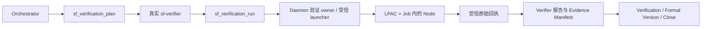

# 受控隔离验证能力提案

PROPOSAL_ID=VERIFICATION-ISOLATION-PROPOSAL-001
STATUS=PROPOSED_NOT_APPROVED
AUTHORITY_CHANGED=NO
BUSINESS_TESTS_EXECUTED=NO

建议先增加 **Windows x64、LPAC/AppContainer + Job Object 的只读 Node 验证入口**。先在自有合成夹具证明隔离，再接正式工具、证据和 Gate，最后恢复原 WI。现有 sf_safe_bash 继续保持 D18 只读边界。这份文件是供产品裁决的具体提案，尚未启用任何执行能力。

## 事实与责任归属

CONFIRMED：本轮 Bootstrap 的本地/远端 main 均为 bb7780cc，初始工作区干净。0003/0005 新取证确认原 WI-0001 仍 implementation_running、代码权限撤销、业务提交 f5fed085；五个业务文件及 WAL 与昨日封存字节一致。0004 当前 daemon 1.0.21/PID21644 健康，0005 磁盘二进制仍匹配昨日核验的 fcf5ce5e…710。

CONFIRMED：真实链路为 sf_safe_bash handler → safeBashExecute → sf_safe_bash_executor.executeCommand。最终 executor 只解释 pwd/read/list/exists/hash 等有限操作，不产生进程调用；部署备用 sf_verifier_execution_core.execPromise 同样调用这一只读执行器。sf_verification / Verification Gate 负责核验报告与证据，不是已存在的隔离测试 Producer。源码/模板及安装哈希已固化到 architecture-baseline.json。

CONFIRMED：0002 主机只读探测为 Windows 10.0.26100 x64；PATH未发现docker/podman/cl/clang，标准Docker与WindowsSandbox入口不存在；存在WSL/HCS、正在运行的WSL/vmcompute服务、一个WSL登记项及.NET编译器。这里只证明发现范围；不证明任何容器或AppContainer已配置安全，更不能把WSL默认环境当作隔离。未启动WSL发行版、Sandbox、测试或新profile。

当前能力判断：D18内部只读执行 SUPPORTED；业务脚本/测试的完整受控路径 UNSUPPORTED；Windows LPAC后端的本机可用性 INSUFFICIENT_EVIDENCE。首个责任层是产品执行合同与缺失的受控 Execution Producer，不是Executor任务文字或Verifier替换命令的问题。

## 拟裁决的首期范围

1. 只开放版本化 profile `windows-lpac-node-readonly/v1`，入口为既有批准Task中的 Node内置测试、已冻结Node内联验收探针，以及明确支持的只读静态检查。没有任意命令、程序路径、env、stdin或宿主cwd透传接口；不运行npm安装、构建工具、第三方框架、服务器或联网测试。
2. 仅在不可变输入副本上运行。测试代码仍视为不可信；原项目、.git、.specforge、用户主目录及凭据不授予访问。应用可读资源仅为冻结输入、固定Node运行文件和明确的最低系统资源。首期不授予应用文件写权限；包括新建私有profile/临时目录的写权限也须收紧并验证。因此需要写磁盘临时文件的测试不在首期范围，不能偷偷加scratch目录兜底。
3. LPAC不授予网络、广泛文件、COM或注册表扩展能力；最小环境从零构造，剔除NODE_OPTIONS等注入与用户凭据。Node权限标志只能作为补充，不能当作安全边界。LPAC机制的依据为[Microsoft启动文档](https://learn.microsoft.com/en-us/windows/win32/secauthz/implementing-an-appcontainer)，Node自身限制见[官方安全说明](https://github.com/nodejs/node/blob/main/SECURITY.md)。本机能否以这些最小权限运行Node仍待PoC证明。
4. 每次执行使用独立SID/profile与Job。以挂起主线程创建LPAC进程，核验token、有效ACL和Job关联后才运行；后代进程必须继续受同一安全边界约束。Job禁用breakaway、设置进程/内存/时间上限、关闭最后句柄即终止进程树。Job只管理生命周期和资源，不能替代LPAC；WMI/COM绕行必须实际拒绝。依据：[Job Objects](https://learn.microsoft.com/en-us/windows/win32/procthread/job-objects)、[创建标志](https://learn.microsoft.com/en-us/windows/win32/procthread/process-creation-flags)。
5. 初始硬上限拟为墙钟120秒、进程32个、总提交内存1GiB、stdout/stderr各1MiB；上限须以Node正例实测冻结。输出截断、缺终止事实、残留进程或任何未能证明的隔离属性都不能产生passed。首期没有应用磁盘写入授权，不能用定时清理冒充磁盘配额。
6. 不静默安装Docker、开启Windows功能、使用WSL默认宿主挂载或改已有系统/业务目录ACL。PoC只允许新建并清理本次owner标记的profile及隔离资源；如果需要更宽capability、可写磁盘、管理员系统设置或另一后端，停止并展示新的具体差异，不能自动降级到普通子进程。

## 正式责任链与接口

拟新增两个精确注册工具：`sf_verification_plan`（sf-orchestrator）和 `sf_verification_run`（sf-verifier）。名字是拟议接口，不代表当前存在。handler共同责任层强制真实调用身份、权威状态和权限检查，不能依赖可关闭的RBAC或caller自报角色。只允许implementation_running中的实施验证及verification_running中的正式验证；工具本身不推进工作流、不放行代码权限。

Plan从正式StateManager、已批准/合并Task、PSV/Manifest、当前实现、Task命令及生效profile生成不可覆盖计划。绑定项目/WI/Task、源提交与分支、完整输入路径与原始字节哈希、命令身份/实际argv、Node版本与文件指纹、launcher指纹、资源策略和隔离合同版本。调用者只选择Task/声明命令标识，不提交新的脚本正文、路径或权限。缺配置、HardStop、链接/硬链接、外部目录、歧义路径、额外依赖和源漂移在启动前拒绝。

Run只消费实际计划哈希。输入副本先检查、复制、复算再封存；不能挂载原仓库。源在执行前、结果接受前及Gate/Close消费时重新核验，执行旧副本不证明当前实现已通过。代码权限保持撤销；验证许可与代码写许可分开，不在work_item.json复制权威工作流状态。

Launcher为固定、哈希校验的第一方Windows资产，构建时编译，运行时不借PowerShell/Add-Type或临时脚本自举。Daemon只传受控计划和一次性身份；应用stdout与受信控制回执使用独立通道，子进程不能把打印的JSON冒充owner回执，也不能访问daemon凭据/继承额外句柄。仅接收有界输出与退出事实，不导入任何应用生成的项目文件或任意路径产物。

原始回执由受信owner追加保存，至少含plan/input/profile身份、实际运行文件和argv、真实UTC、启动/终止事实、数字退出码或明确未启动、timeout/输出完整性、Job全部后代结束证据、输出哈希及前后源身份。未知不能填0，拒绝不能算测试失败或通过。报告可引用回执，不能由Agent手写同名回执；日志只记录安全摘要，原始输出与脱敏发布副本分别绑定哈希。

Verification/Evidence/Close共同消费同一回执校验器。计划、源、原始回执或审计任一漂移使旧结果失效。文件身份、实际执行、业务断言、人工验收分别证明；真实执行成功也不自动证明需求全部满足。原流程的Gate、Formal Version、semantic closure、Close及业务main合并条件均保持独立。

## 原任务兼容是单独前置条件

原Task既有Node测试/e2e，也有POSIX `test`、`grep`、否定和组合表达式。不能把当前Read/Grep工具结果填成这些命令已执行、退出0。

首期只读静态profile可采用版本化有限解释器，保留原声明命令、解析树及语义版本，同时明确实际执行种类，逐条证明存在性、逐行计数、BRE/ERE、引号、否定和短路语义；不使用match次数冒充grep匹配行数，不修改模式或减少断言。动态展开、未支持语法和任何不能证明等价的命令保持not_executed。这一执行种类及证据含义必须先进入正式合同并被Task/Report/Gate消费者接受，不能由实现事后解释。

如果无法合法承接原Task的精确证据要求，由原专业owner报告CONTRACT_CONFLICT并形成具体受控修订方案；不手改sealed Candidate、不重复原审批/Spec Merge，也不为过Gate把验收降为静态检查。首期能力通过，不等于原Task所有命令自动可运行。

## 失败与恢复

执行Attempt独立于工作流状态，采用追加历史与不可覆盖结果。启动失败、token/Job检查失败、限额、取消、daemon/launcher崩溃、源漂移分别记录；成功步骤先固化，外围采集失败不能把已运行改成未运行。launcher关闭须杀完整Job，daemon中断另有受控心跳/总时限；重启先核验进程、原始回执和残留，不盲重跑。

恢复只回收经过SID/profile/路径/owner标记验证的本次资源。无法证明无进程或资源归属时保留现场并blocked；不删除原项目或旧证据。中断Attempt永不补写passed；必要重试产生新Attempt，并重新冻结输入及命令身份。

## 实施与验收顺序（批准后才执行）

| 阶段 | 完成条件 | 失败后的边界 |
|---|---|---|
| A 权威合同 | 将本次明确产品决定写入SPS §9.2和Registry；正式声明有限例外、所有权、profile和回执；D18默认仍有效 | 没有决定不改产品执行代码 |
| B 独立PoC | 只用自有合成夹具，证明Node正例；恶意父/子/孙进程访问影子项目、假配置/凭据哨兵、测试网络/注册表/进程、宿主路径/UNC/链接别名均不能越界；私有profile不形成未授权持久写入。不读取真实用户凭据，不把原业务现场当攻击夹具 | 任一未证明或失败均不接业务，不放宽权限 |
| C 生命周期 | 真实进程终止、超时/内存/进程数/输出限额、breakaway与WMI路径、取消、launcher/daemon崩溃及重启；独立查询进程树和文件字节，不只检查一个通知 | 保留失败Attempt，不能由mock或普通子进程代替 |
| D 产品接线 | public wrapper→Dispatcher/handler→Runtime owner→真实launcher→原始回执→Verifier→共同Gate/Close消费者；角色、HardStop、计划篡改、源漂移、未知字段、复制回执均拒绝 | 不允许只测库而宣称入口已接通 |
| E 发布部署 | 源码、两Tool、Agent/Skill、状态/报告Schema、插件精确工具登记、安装器、原生launcher发布集合与回归同步；类型/构建/release precheck，停旧daemon，安装哈希与新进程实际行为验证 | 新资产或编译依赖不完整即发布失败，不能运行时下载自修 |
| F 恢复原WI | 重读同一WI/PSV-0002/f5fed085；按已批准Task生成新计划；取得实际命令证据后再由原流程判断任务完成及正式验证 | 原审批/分支决定不重问；无真实证据不implementation_done/verification_done/Close；业务main合并仍独立确认 |

验证矩阵须在执行前冻结，包含合法正例、实际恶意反例、失败后零原项目写入、真实进程重启、源码/部署一致性和所有消费入口。不能仅证明正例能运行，也不能用“目录副本+普通进程”或Node权限标志通过隔离验收。

## 拟修改面与当前停点

批准后的实现范围拟覆盖：SPS/Registry；Daemon执行owner、独立隔离launcher和字段级schema；两个wrapper及精确工具登记/权限；实际Orchestrator/Executor/Verifier和Workflow Skill消费者；Verification/Evidence/Changed Files Audit/Close；launcher构建、安装/发布清单；单元、真实OS隔离、进程中断、公共入口与部署验证。不得新增SpecForge自我治理WI或硬编码原WI。

本轮只写提案、证据、经验及唯一状态文件；以上实现尚未开始。下一步需要用户对这项有限Windows方案作明确产品决定。原Candidate批准、归档恢复授权和具体分支名确认都已完成，无需重复。
